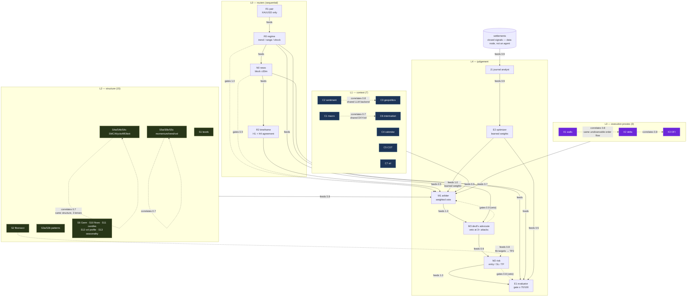

# Gold Council — Agent Relationship Graph

**Date:** 2026-11-15 | **Status:** seeded in Supabase `agent_links` (73 rows, all `source='manual'`).
**Seed script:** `design/scripts/seed-agent-links.py` (idempotent — re-run updates, never duplicates).
**Target:** Gold Council Supabase project `xxbtrtdjijrhmcbzmxxm` (direct Postgres). Never the Eye of Justice project.

## What this graph is

Directed, weighted, typed edges between the 35 agents (plus one data node,
`settlements`), derived from the real code — `system/pipeline.py`,
`system/m1_arbiter.py`, `system/m2_risk.py`, `system/patterns/{evaluator,optimizer}.py`,
`system/agents/{r0_regime,n0_news,r1_pair,r2_timeframe,m3_devil,j1_journal}.py` —
and from `design/arch.md` §2.

## ⚠️ Honest status: strengths are manual design judgment, NOT measured

- **Every row is `source='manual'`, `sample_n=0`.** No strength here was
  computed from vote history or backtest data. The numbers (0..1) are my
  design judgment about how strongly one agent's output should influence
  another, grounded in the code paths listed in the table.
- **Measured per-agent performance lives elsewhere:** E2's walk-forward
  R-expectancy (in `learned_weights_history` / `system/data/learned_weights.json`):
  only 5 of 25 voters are positive — X3 1.672, S5b 1.23, S5c 0.902, S4b 0.672,
  X2 0.524; all others 0 (zeroed). Those are the weights M1 actually applies.
  They are **not** the same thing as these link strengths.
- **How the graph becomes measured:** E2/J1 should replace `manual` rows with
  `source='walk-forward'` / `'live'` rows carrying a real `sample_n` once vote
  history is large enough (see "Maintenance" below). A correlation claimed on
  12 samples is not trusted like one on 1,200 — that is why `sample_n` exists.

## Diagram

Notes on the diagram: family `correlates` edges are drawn once per family for
readability — in the database each pair is stored in **both directions**
(e.g. `S4a→S4b` and `S4b→S4a`), 24 rows total. `settlements` is a data table,
not an agent; it is included because it is the learning loop's input into J1.

## Edge tables

### 1. L0 router sequence — feeds (3 rows)

| from | to | type | strength | Reason (code) |
|---|---|---|---|---|
| R1 | R0 | feeds | 0.9 | Symbol routing precedes regime classification; R0 analyzes the routed symbol's data (`pipeline.py`). |
| R0 | N0 | feeds | 0.7 | Regime check precedes news check in the pipeline sequence. |
| N0 | R2 | feeds | 0.7 | News check precedes timeframe agreement. |

### 2. Gates — a gate can veto/block its target (4 rows)

| from | to | type | strength | Reason (code) |
|---|---|---|---|---|
| R0 | M1 | gates | 1.0 | Allowed-list zeroes disallowed schools; `shock` regime = all zero (`m1_arbiter.py`, `r0_regime.py` ALLOW). |
| N0 | M1 | gates | 0.9 | News block aborts the whole pipeline before M1 (`pipeline.py` → `blocked_by_news`). |
| M3 | M1 | gates | 0.9 | Veto at 3+ structural attacks kills the verdict (`m3_devil.py`, `pipeline.py` s_devil). |
| M2 | E1 | gates | 0.8 | M2 returns `None` on invalid numbers = veto; no card reaches E1 (`m2_risk.py` build_signal). |

### 3. Context feeds into the judges (4 rows)

| from | to | type | strength | Reason (code) |
|---|---|---|---|---|
| R0 | E1 | feeds | 0.6 | E1 scores regime fit (15/100) (`evaluator.py`). |
| N0 | E1 | feeds | 0.6 | E1 scores the news-free window (10/100) (`evaluator.py`). |
| R0 | M3 | feeds | 0.5 | M3 attacks a mixed regime (`m3_devil.py`). |
| R2 | M1 | feeds | 0.5 | H1/H4 agreement is decision context. **Caveat:** not an `arbitrate()` input in the current code — recorded context only. |

### 4. Voting agents → M1 — feeds (25 rows)

Strength is a layer judgment: L2 structure is the primary vote source (0.8),
L3 execution proxies are degraded by proxy status (0.7), L1 context votes (0.6).

| layer | agents | strength |
|---|---|---|
| L1 context | C1, C2, C3, C4, C5, C6, C7 | 0.6 |
| L2 structure | S1, S2, S3a, S3b, S4a, S4b, S4c, S5a, S5b, S5c, S6, S10, S11, S12, S13 | 0.8 |
| L3 execution proxies | X1, X2, X3 | 0.7 |

Each agent's vote is M1's input (`pipeline.py` roster → `arbitrate()`). M1
applies E2's learned weights on top — the weights are the measured part, the
feeds strength above is judgment.

### 5. Review chain — feeds (3 rows) + S2 → M2 (1 row)

| from | to | type | strength | Reason (code) |
|---|---|---|---|---|
| M1 | M3 | feeds | 1.0 | M3 challenges M1's verdict (`pipeline.py` s_devil). |
| M3 | M2 | feeds | 0.9 | Challenged verdict (+challenge) flows to risk (`pipeline.py` s_risk). |
| M2 | E1 | feeds | 1.0 | E1 evaluates M2's card (`pipeline.py` s_eval). |
| S2 | M2 | feeds | 0.8 | Fibonacci targets feed TP2 — a fib target beyond TP1 overrides the 3R default (`pipeline.py` s_risk, `m2_risk.py`). |

### 6. Learning loop — feeds (4 rows)

| from | to | type | strength | Reason (code) |
|---|---|---|---|---|
| settlements | J1 | feeds | 0.9 | J1 reads closed signals / settlements. `settlements` is a data table, not an agent. |
| J1 | E2 | feeds | 0.9 | Per-direction win rates feed weight learning (`j1_journal.py` → E2). |
| E2 | M1 | feeds | 1.0 | Learned weights are M1's weight input (`m1_arbiter.py` `weights` param, `optimizer.py` `learn_weights`). |
| E2 | E1 | feeds | 0.5 | E1's consensus excludes zero-weight agents (weights applied by M1 from E2 — indirect, hence 0.5). |

### 7. Same-family correlates — bidirectional (12 pairs = 24 rows)

Each pair is stored in **both directions** so the graph is queryable from
either side. Purpose (per `schema.sql`): M1 must not double-count two agents
linked with `correlates` / strength near 1 — E2 shrinks their combined weight.

| pair | strength | Reason |
|---|---|---|
| S4a ↔ S4b, S4a ↔ S4c, S4b ↔ S4c | 0.7 | Same structure data, three lenses (SMC / Wyckoff / Elliott). |
| S5a ↔ S5b, S5a ↔ S5c, S5b ↔ S5c | 0.7 | Same indicator family (momentum / trend / volatility). |
| X1 ↔ X2, X1 ↔ X3, X2 ↔ X3 | 0.8 | All three proxy the same unobservable order flow — highest double-counting risk. |
| C2 ↔ C3 | 0.8 | Shared LLM backend (3a2l) + shared abstention mode (both abstain without it). |
| S3a ↔ S3b | 0.6 | Harmonic vs classical patterns, same price data. |
| C1 ↔ C6 | 0.7 | Shared DXY + oil inputs (both read `ctx["dxy"]` / `ctx["oil"]`). |

### 8. Confirms / contradicts (5 rows)

| from | to | type | strength | Reason |
|---|---|---|---|---|
| S1 | S3b | confirms | 0.7 | Confirming on a double top/bottom (`arch.md` §2). Stored both directions. |
| S3b | S1 | confirms | 0.7 | Same as above, reverse direction. |
| S1 | S2 | confirms | 0.6 | Fibonacci levels are drawn on S/R levels; agreement raises weight. Stored both directions. |
| S2 | S1 | confirms | 0.6 | Same as above, reverse direction. |
| S5c | S5b | contradicts | 0.6 | Volatility expansion contradicts trend (`arch.md` §2). One direction only. |

## Counts

| link_type | rows |
|---|---|
| feeds | 40 |
| correlates | 24 |
| confirms | 4 |
| gates | 4 |
| contradicts | 1 |
| **Total** | **73** |

All 73 rows: `source='manual'`, `sample_n=0`, `updated_by='manual-seed'`.

## Maintenance (for E2 / J1)

1. **Do not hand-edit in production without an audit row** (per `schema.sql`
   comment). Changes go through the seed script or an E2 run that writes
   `updated_by='E2'`.
2. **Replacing manual strengths with measured ones:** when a `correlates` /
   `confirms` / `contradicts` pair has enough vote history, E2 computes the
   real agreement/correlation from `agent_votes` + `settlements`, sets
   `source='walk-forward'` (or `'live'`) and a real `sample_n`. Until then
   the manual value stands and must be labelled as such wherever it is shown.
3. **Double-counting guard:** before M1 sums a vote, check `agent_links` for
   a `correlates` edge with strength ≥ 0.7 to an already-counted agent and
   shrink the combined weight (E2's shrinkage `n/(n+20)` is the same idea for
   small samples).
4. **Regime gap (known):** `regime` is NULL on all signals in Supabase (the
   pipeline never populated it), so regime-filtered retrieval is not possible
   until the pipeline fills it. The R0 edges above are structural, not
   data-backed, for the same reason.
5. **Re-seed:** `~/workspace/goals/goal/system/venv/bin/python design/scripts/seed-agent-links.py`
   — safe to re-run; it upserts and reports inserted/updated counts.

## Verification (2026-11-15)

- Seed run: 73 inserted, 0 updated, total 73.
- Independent psql check: count 73; chain M1→M3 (feeds 1.0), M3→M2 (feeds 0.9),
  M2→E1 (feeds 1.0 + gates 0.8); loop settlements→J1 (0.9), J1→E2 (0.9),
  E2→M1 (1.0); all 4 gates present; all 5 confirms/contradicts present;
  all 73 rows `source='manual'`.
- Re-run (idempotency): 0 inserted, 73 updated, total still 73.
