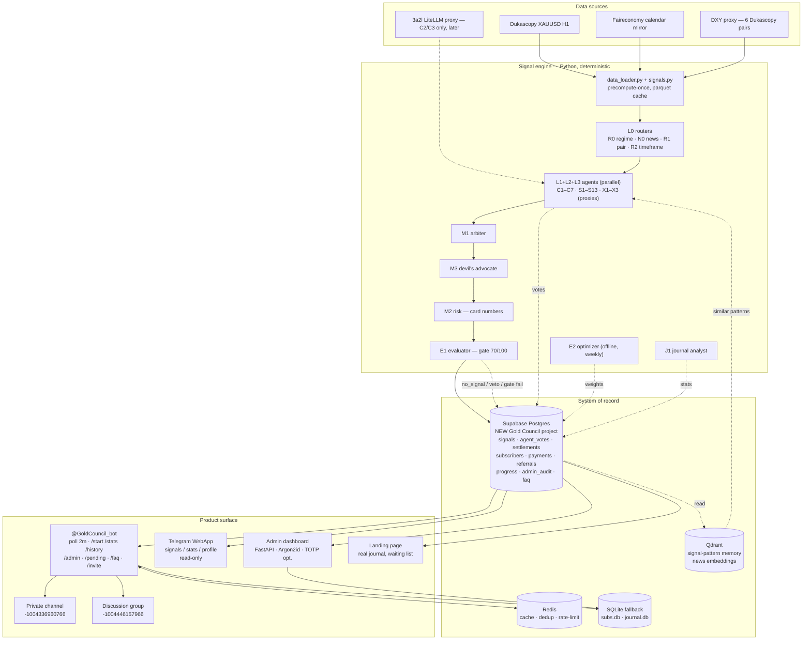
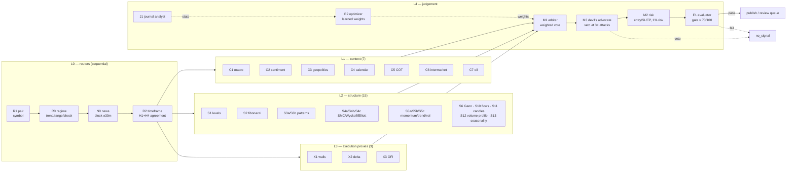
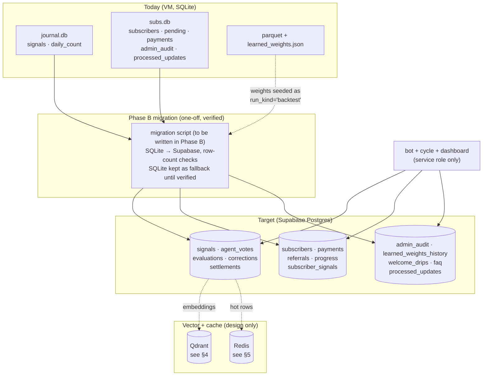

# Gold Council — Architecture (DESIGN ONLY)

**Date:** 2026-11-11 | **Status:** design package, no build.
**Staging:** `~/workspace/goals/goal/design/` → `D:\Project\Trade` on Narmer (Phase G only).
**Full proposal:** `00-proposal-alpulse-additions.md`. **Schema:** `supabase/schema.sql`. **Workflows:** `workflows/*.json`.

## Hard rules (repeat — they constrain every diagram below)

- NO auto-trading ever. Recommendations only, never execute trades. No broker integration, no Pocket Option anywhere.
- Paper labelled paper. Losers shown. No fake numbers. 3/day cap (ceiling). Review mode first, auto after ~30 reviewed signals.
- Honest state: strategy has **no proven edge yet** (latest walk-forward OOS +$990.87, +9.9%, 45.1% win, +0.061R/trade, t-stat +0.75).

## Current state (today, VM)

- Bot: `@GoldCouncil_bot` (id 9096066622), private channel `-1004336960766`, discussion supergroup `-1004446157966`, admin Mohamed (Telegram ID 2122313931, @Dr_Robot_Eg), mode **review**.
- Code: `~/workspace/goals/goal/system/` — 35 agents, `pipeline.py` (orchestrator), `patterns/` (chain / parallel / evaluator / optimizer), `journal.py`, `telegram_bot/` (poll, cycle, review, publisher, settle, expiry, store, cards, charts, commands), `dashboard/` (FastAPI 127.0.0.1:8100, Argon2id, TOTP optional, Telegram-only control chosen 2026-11-06).
- Data today: SQLite `telegram_bot/subs.db` (subscribers, deliveries, subscriber_signals, pending, payments, admin_audit, admin_rate, login_attempts, processed_updates) + `data/journal.db` (signals, daily_count) + parquet caches + `data/learned_weights.json`.
- Crons (VM): `trading-bot-poll` 2 min, `trading-bot-cycle` 1 h, `trading-dashboard-watchdog` 15 min.
- Landing: artifact `mjls-ldhhb-gold-council`, CTA https://t.me/Dr_Robot_Eg, waiting-list only — paid closed until the documented paper month completes.

## Target state (after Phases B–G)

SQLite becomes a local fallback; Supabase Postgres becomes the system of record for signals, votes, evaluations, corrections, settlements, subscribers, payments, referrals, progress, audit, learned weights, drips and FAQ. Qdrant holds vector memory (signal patterns, news embeddings). Redis holds cache / dedup / rate-limit state. The WebApp reads published signals, progress and FAQ. The bot server and dashboard server are the only writers (service role). Narmer (`D:\Project\Trade`) becomes the live host in Phase G.

## 1. System architecture



Notes:
- The dashed edge from 3a2l is **later** — C2/C3 abstain without it; they never fabricate sentiment or geopolitics.
- X1/X2/X3 are CME/Dukascopy **proxies**; spot FX has no central order book and the design says so in the UI copy and in `agent_votes.degraded`.
- E2 never runs inside the hourly cycle. It is a separate weekly job; its output lands in `learned_weights_history` with run_kind, sample_n and t_stat.

## 2. Agent voting graph (how a signal is decided)



Vote contract (unchanged): `analyze(df/ctx) -> {agent, signal +1/-1/0, confidence 0-100, detail (Arabic)}`. Every vote is stored in `agent_votes` — including abstentions (`vote=0, degraded=true, degrade_reason`).

### Inter-agent links (`agent_links`)

Typed, directed, weighted edges maintained by E2/J1:

- `gates`: N0 → everything (news block), M2 → everything (risk veto), M3 → M1 (veto).
- `feeds`: S2 → M2 (Fibonacci targets feed the card), R0 → M1 (regime silences unsuitable schools), C6 → C1 (DXY feeds macro).
- `confirms` / `contradicts`: learned from vote history (e.g. S1 and S3b confirming on a double top/bottom; S5c contradicting S5b in volatility expansion).
- `correlates`: votes that move together. M1 must not double-count a correlated pair — E2 shrinks their combined weight. This is why `agent_links.strength` and `sample_n` exist: a correlation claimed on 12 samples is not trusted like one on 1,200.

## 3. Data flow — SQLite today → Supabase target



Migration rules (Phase B, to be written as a script then):
1. Migrate in dependency order: subscribers → signals → agent_votes (rebuilt from `votes_json` where present; rows without per-agent detail are flagged `degraded=true, degrade_reason='migrated from votes_json'`) → settlements → the rest.
2. Row-count check per table, then a spot check of 5 signals end-to-end (card text, votes, settlement).
3. Keep SQLite writing in parallel (dual-write) for one week; cut over only after the counts match for 7 consecutive daily cycles.
4. Never delete the SQLite files. They are the fallback and the audit trail for the paper phase so far.

## 3b. Database ERD (Supabase Postgres — matches `supabase/schema.sql`)

```mermaid
erDiagram
    signals ||--o{ agent_votes : "one vote per agent"
    signals ||--o{ evaluations : "E1 gate, one per eval"
    signals ||--o{ corrections : "M3 challenges"
    signals ||--|| settlements : "one outcome per signal"
    signals ||--o{ subscriber_signals : "journal rows"
    subscribers ||--o{ subscriber_signals : "sees during active sub"
    subscribers ||--o{ payments : "manual payments"
    subscribers ||--o{ referrals : "refers others"
    subscribers ||--o{ welcome_drips : "drip steps"
    subscribers ||--|| progress : "one progress row"
    subscribers ||--o{ subscribers : "referred_by"
    referrals }o--|| subscribers : "referred user"
    agent_votes }o--|| agent_links : "votes feed link learning"
    learned_weights_history }o--|| agent_votes : "weights from votes + settlements"
    settlements }o--|| signals : "closes"
    faq ||--o{ faq : "no FK — standalone content table"
    admin_audit ||--o{ admin_audit : "no FK — append-only log"
    processed_updates ||--o{ processed_updates : "no FK — idempotency set"

    signals {
        bigint id PK
        text symbol
        text direction
        numeric entry
        numeric stop_loss
        numeric tp1
        numeric tp2
        int confidence
        int e1_score
        text mode "paper|live"
        text status "open|tp1|tp2|sl|expired"
        numeric pnl_r
        date day_utc
        smallint daily_seq "1-3, the 3/day cap"
        text review_status
    }
    agent_votes {
        bigint id PK
        bigint signal_id FK
        text agent "35 agents"
        text layer
        smallint vote "-1|0|1"
        int confidence
        text detail
        numeric weight
        boolean degraded
    }
    agent_links {
        bigint id PK
        text from_agent
        text to_agent
        text link_type "confirms|contradicts|gates|feeds|correlates"
        numeric strength "-1..1"
        text source
        int sample_n
    }
    evaluations {
        bigint id PK
        bigint signal_id FK
        int score
        boolean passed "score >= 70"
    }
    corrections {
        bigint id PK
        bigint signal_id FK "nullable — vetoed proposals"
        int attacks
        boolean veto "at 3+ attacks"
    }
    settlements {
        bigint id PK
        bigint signal_id FK "unique"
        text outcome "tp1|tp2|sl|expired"
        numeric pnl_r
    }
    subscribers {
        bigint telegram_id PK
        text status "active|paused|expired|kicked"
        timestamptz expires_at
        bigint referred_by FK "self, no self-referral"
        smallint drip_stage
    }
    payments {
        bigint id PK
        bigint subscriber_id FK
        numeric amount
        text method "bank|vodafone_cash|usdt|other"
        int period_days
    }
    referrals {
        bigint id PK
        bigint referrer_id FK
        bigint referred_id FK "nullable until joined"
        text status "invited|activated|rewarded|rejected"
        int reward_days "default 7, 0-30"
    }
    progress {
        bigint subscriber_id PK FK
        int signals_seen
        int signals_entered
        int wins
        int losses
        numeric win_rate
        int current_streak
        int best_streak
    }
    learned_weights_history {
        bigint id PK
        timestamptz run_at
        text run_kind "backtest|walk-forward|live"
        text agent
        numeric weight
        numeric r_expectancy
        int sample_n
        numeric t_stat
    }
    welcome_drips {
        bigint id PK
        bigint subscriber_id FK
        smallint step "1-4"
        text status "scheduled|sent|skipped|cancelled"
        timestamptz scheduled_for
    }
    faq {
        bigint id PK
        text question
        text answer
        text lang "ar|en"
        boolean is_active
    }
    admin_audit {
        bigint id PK
        timestamptz ts
        bigint admin_chat_id "0 = web dashboard"
        text action
        text target
        boolean ok
    }
    processed_updates {
        bigint update_id PK
        timestamptz processed_at
    }
```

## 4. Qdrant collections design (design only — no collections created)

Cluster today: the existing Qdrant Cloud cluster (Eye of Justice) is **empty** (verified 2026-11-10, 0 collections). Decision open: new collections on that cluster, namespaced `gc_*`, or a new cluster (see `D-Project-Trade-structure.md`).

| Collection | Vector | Payload | Purpose |
|---|---|---|---|
| `gc_signal_patterns` | 384-dim (embedding model to be chosen in Phase B; sentence-transformers-class, local, no API cost) | signal_id, symbol, direction, regime, outcome, pnl_r, agent votes summary | "Has a setup like this worked before?" — retrieve similar past signals at E1 time, as *context* for the gate, never as a vote by itself. |
| `gc_news_embeddings` | 384-dim, same model | date, source, headline/summary (Arabic + English), linked signal_ids | C2/C3 memory: what did similar news do to gold last time? Abstain when no similar item is found. |

Rules:
- Qdrant is **memory, not the system of record**. If Qdrant is down, the cycle continues without it (vectors are advisory only).
- No outcome is ever written to Qdrant before it is settled in Postgres. Unsettled signals are never embedded as "wins".
- Payloads contain no subscriber data, no Telegram ids, no payment data.

## 5. Redis key design (design only — no Redis connector exists)

Choice open: local Redis on Narmer (Docker) vs cloud Redis. The keyspace below works for either.

| Key pattern | Type | TTL | Purpose |
|---|---|---|---|
| `gc:updates:seen:{update_id}` | SET member | 7 days | Fast-path dedup for poll.py (durable record stays in `processed_updates`) |
| `gc:offset` | STRING | none | Last processed Telegram offset (file `.offset` today) |
| `gc:ratelimit:admin:{chat_id}:{minute}` | INCR | 60 s | 20 admin actions/min (today: `admin_rate` table) |
| `gc:ratelimit:login:{ip}:{window}` | INCR | 15 min | 5 failed dashboard logins / 15 min per IP (today: `login_attempts` table) |
| `gc:cache:signal:{signal_id}` | HASH | 8 h (signal validity) | Published card + chart path for the WebApp |
| `gc:cache:stats:{subscriber_id}` | HASH | 5 min | /stats + progress (recomputed from Postgres on miss) |
| `gc:lock:cycle` | STRING (SET NX) | 10 min | Prevent two cycle.py runs overlapping after a slow run |
| `gc:queue:drip:due` | ZSET (score = due time) | — | Welcome-drip due queue (durable rows in `welcome_drips`) |

Rules:
- Redis is **cache, not truth**. Every key has a Postgres table behind it. Losing Redis loses speed, never data.
- No secrets in Redis. No tokens, no passwords, no Supabase keys.

## 6. WebApp design (item 1 — outline, no code in this package)

- Served as static files (HTML/CSS/JS, Arabic RTL, dark) from the FastAPI dashboard host or a static host chosen in Phase C.
- Auth: Telegram `WebApp.initData` validated server-side (HMAC with the bot token, never in the client). No passwords, no separate login.
- Tabs (mirroring AlPulse's 5-tab layout, Gold Council content): **الإشارات** (published cards + chart, paper tag), **الملف الشخصي** (name, status, expiry, progress: signals seen / entered / wins / losses / win rate / streak), **الدعم** (FAQ from `faq` table + discussion-group link + contact Mohamed), **المساعد** (phase 2 — placeholder in Phase C, live in Phase F), **الدعوات** (personal invite link + invited count + reward days earned).
- All numbers come from Supabase reads (service role via a thin API, never direct DB access from the client). Pending/review signals are never shown.
- The WebApp shows **no trading button**. No buy/sell, no deposit, no broker link. The only actions are: view, copy the invite link, open the discussion group, contact Mohamed.

## 7. Intro video — 1-minute script outline (item 5, outline only)

60 seconds, Arabic, Egyptian dialect. No video generated in this package.

| Time | Visual | Voiceover (draft) |
|---|---|---|
| 0:00–0:08 | Gold Council logo, XAUUSD chart | "مجلس الذهب — توصيات دهب وفوركس مبنية على تحليل، مش على توقعات." |
| 0:08–0:20 | 35 agents → one card (animation) | "35 وكيل تحليل بيصوتوا على كل توصية: مستويات، فيبوناتشي، أخبار، دولار — وبعدها مراجعة بشرية قبل النشر." |
| 0:20–0:32 | Signal card: entry / SL / TP / chart | "كل توصية فيها الدخول والوقف والهدفين والثقة — وصورة شارت واضحة." |
| 0:32–0:45 | Journal: wins and losses side by side | "والسجل معلن: الرابحة والخاسرة مع بعض. حاليا كل التوصيات ورقية، لحد ما نكمل شهر موثق." |
| 0:45–0:55 | 3/day cap, review mode | "حد أقصى 3 توصيات في اليوم — ويوم مفيهوش فرصة، مفيهوش توصية. مفيش تداول آلي، ومحدش بيتداول مكانك." |
| 0:55–1:00 | CTA: t.me/Dr_Robot_Eg | "تابع القناة، وادخل قائمة الانتظار." |

Open question: who records the voiceover (Mohamed or a narrator)? See `00-proposal-alpulse-additions.md`.

## 8. Smart assistant — phase 2 outline (item 7)

- Scope: answer questions **only** from (a) published signal cards, (b) the subscriber's own /stats, (c) the FAQ table, (d) the design doc's honest-results section.
- Refuse / abstain: any question about future prices, any request to trade, any broker question, anything not in the four sources above. Abstention text is fixed: "معنديش بيانات موثقة عن ده."
- Depends on: 3a2l LLM routing for C2/C3 first (the same routing the assistant will use). No separate LLM key.
- No memory of subscriber conversations is stored outside the existing audit log. No training on subscriber messages.

## 9. Risks and honest caveats (kept in the design, not buried)

- Strategy has no proven edge yet (t-stat +0.75). The learning DB makes the *measurement* better; it does not create an edge. Say so in the WebApp, the video, and the landing page.
- Supabase is cloud, not local. "Everything local on Narmer" and "Supabase" are in tension: the design resolves it as **code + SQLite fallback local on Narmer, system-of-record Postgres in Supabase cloud**. If Mohamed wants Postgres local too, that is a different design (self-hosted Supabase is heavy — flagged before for the 8GB Celeron-class box) and must be decided explicitly.
- The VM reboots several times a day; Narmer's uptime is unproven for 24/7 service. Phase G must include a 1-week uptime observation before the VM crons are switched off.
- The 2026-11-08 stale-data incident (cycles used a Dukascopy timestamp ~2 days old) is a known failure mode: the cycle workflow has a staleness abort (§signal-cycle.json, `load_data.on_error`).
