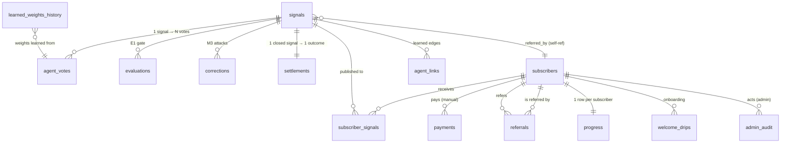

# خطة نقل سجل التوصيات إلى Supabase + شجرة العلاقات

**الحالة: تصميم/مراجعة فقط — لا تنفيذ قبل وصول مفاتيح Supabase (URL + anon/service_role) + «نفذ» صريح من محمد. ملف المشروع وصل 2026-11-14 ~02:55 (`Data.txt`) لكنه لا يحتوي مفاتيح Supabase.**
**المصدر الحي للنقل هو نارمر (`D:\Project\Trade\system\data\journal.db` + `telegram_bot\subs.db`) — مش نسخة الـ VM الأرشيفية.**
**ملحوظة تنفيذية: نارمر غير واصل حاليًا (محاولتا SSH فشلتا 2026-11-15 ~05:23 EET — القطع المتعمّد المتوقع في وضع on-demand). خطوة التحقق الحي من الأعمدة والصفوف تتم وقت التنفيذ بعد ما محمد يشغّل Tailscale + sshd بنفسه.**

## 1. الهدف

- سجل التوصيات (اللي بيتعلم منه J1) يبقى على Supabase بدل SQLite المحلي، بعلاقات حقيقية (مفاتيح أجنبية) بين الجداول — مش ملفات منفصلة.
- مخطط Supabase جاهز أصلًا: `design/supabase/schema.sql` — 16 جدول، RLS على الكل، 24 سياسة، و7 أسئلة FAQ.
- SQLite يفضل موجود كمصدر احتياطي لحد ما يُعلن التبديل (cutover) بأمر منفصل.

## 2. الوضع الحالي (متحقق منه)

| المصدر | الجداول | الحالة (آخر تحقق 2026-11-14 ~00:55 EET) |
|---|---|---|
| `journal.db` (نارمر) | `signals`, `daily_count` | 12 صفًا = 4 صفقات مميزة (كل واحدة 3×)؛ 6 `sl` + 6 `tp1`؛ `daily_count` 3/يوم × 4 أيام |
| `subs.db` (نارمر) | `subscribers`, `deliveries`, `subscriber_signals`, `pending`, `payments`, `admin_audit`, `admin_rate`, `login_attempts`, `processed_updates` + جداول المجتمع (`result_posts`, `polls`, `welcome_drips`, `referrals`) | `pending`: 12 صفًا كلها `rejected`؛ `result_posts`: 12 |
| Supabase (تصميم) | 16 جدول (انظر §3) | لم يُطبق بعد — بانتظار الملف + نفذ |

## 3. شجرة العلاقات (الهدف)

**بالتفصيل — العلاقات الأساسية:**
- **التوصية هي المركز:** `signals.id` ← `agent_votes.signal_id` (صوت كل وكيل)، `evaluations.signal_id` (بوابة E1)، `corrections.signal_id` (هجمات M3)، `settlements.signal_id` (النتيجة، UNIQUE — نتيجة واحدة لكل توصية مغلقة)، `subscriber_signals.signal_id` (مين استلمها).
- **المشترك:** `subscribers.telegram_id` ← `subscriber_signals.subscriber_id`، `payments.subscriber_id`، `referrals.referrer_id` / `referred_id`، `progress.subscriber_id`، `welcome_drips.subscriber_id` — و`subscribers.referred_by` إشارة ذاتية (مين دعاه).
- **حلقة التعلم:** `signals` → `settlements.pnl_r` → ‏E2 → ‏`learned_weights_history` → ‏`agent_votes.weight` → ‏M1 (التحكيم) → ‏التوصية التالية. وJ1 يقرأ `signals` + `agent_votes` + `settlements`.
- **الروابط بين الوكلاء:** `agent_links` (from_agent → to_agent: confirms / contradicts / gates / feeds / correlates) — دي «العلاقات بينهم» على مستوى الوكلاء نفسهم، مش بس الجداول.

## 4. خريطة النقل (جدول بجدول)

### 4.1 تنقل مباشرة

| SQLite (المصدر) | Supabase (الهدف) | التحويلات |
|---|---|---|
| `journal.signals` | `signals` | `id` يُدرج صراحةً (IDENTITY يسمح) + إعادة ضبط التسلسل بعدها؛ `ts` TEXT ISO → `created_at` timestamptz؛ `entry/stop/tp1/tp2` REAL → numeric(12,2)؛ `stop` → `stop_loss`؛ `status` كما هو؛ `exit_price`/`pnl_r` كما هما؛ `mode` كما هو؛ `day_utc` = تاريخ UTC من `ts`؛ `daily_seq` = ترتيب الصف في يومه (1–3 حسب `ts`) |
| `subs.subscribers` | `subscribers` | `chat_id` → `telegram_id` (PK)؛ `activated_at`/`expires_at` TEXT → timestamptz؛ `warned` INTEGER → boolean؛ `referred_by`/`drip_stage`: لا مصدر في SQLite — تُشتق `referred_by` من `referrals` (أول إحالة) أو NULL، و`drip_stage` = 0 |
| `subs.subscriber_signals` | `subscriber_signals` | `subscriber_chat_id` → `subscriber_id`؛ `signal_id` كما هو؛ `entered_self` INTEGER → boolean |
| `subs.payments` | `payments` | `subscriber_chat_id` → `subscriber_id`؛ `amount` REAL → numeric؛ `method`: خريطة نصوص عربي ← قيم CHECK (`تحويل بنكي`→`bank_transfer`، `فودافون كاش`→`vodafone_cash`، `USDT`→`usdt`، غيرها→`other`)؛ `recorded_by` لا مصدر — يُثبت على رقم محمد الإداري (2122313931)؛ `paid_at` TEXT → timestamptz |
| `subs.admin_audit` | `admin_audit` | `ts` TEXT → timestamptz؛ `ok` INTEGER → boolean؛ كما هي |
| `subs.processed_updates` | `processed_updates` | كما هي (تُقلَّم لآخر 2000 أولًا) |

### 4.2 تندمج في جدول موجود (لا جدول مستقل لها)

| SQLite | الهدف | كيف |
|---|---|---|
| `subs.pending` (طابور المراجعة) | `signals.review_status` / `reviewed_at` / `card_text` / `chart_path` | `pending.signal_id` = `signals.id` (1:1) — حالة المراجعة تُكتب في صف التوصية نفسه؛ `reviewed_by` = رقم محمد الإداري عند الرفض/الموافقة |
| `subs.deliveries` | `signals.channel_message_id` / `published_at` | 1:1 — رقم رسالة القناة وتاريخ النشر يُكتبان في صف التوصية |
| `subs.login_attempts` | `admin_audit` (action=`web:login_failed`, `admin_chat_id`=0) | حسب تعليق المخطط — محاولات دخول الداشبورد الفاشلة صفوف تدقيق |
| `journal.daily_count` | **لا جدول — يُشتق** | `COUNT(*) GROUP BY day_utc` من `signals`؛ السقف 3/يوم يفضل يُنفذ في `log_signal` زي ما هو |

### 4.3 تُشتق من البيانات (لا مصدر مباشر)

| Supabase | المصدر | ملاحظات |
|---|---|---|
| `settlements` | `signals` المغلقة (`status` = tp1/tp2/sl/expired) | صف واحد لكل توصية مغلقة (12 صفًا حاليًا)؛ `outcome`/`exit_price`/`pnl_r` دقيقة من SQLite؛ **`settled_at` غير مسجل في SQLite أصلًا** — يُستخدم وقت النقل كتقريب موثق في سجل النقل، مع `settler='settle.py'` |
| `agent_votes` | `signals.votes_json` (JSON) | **أهم خطوة تحويل:** كل `votes_json` يتفكك لصف لكل وكيل (signal_id, agent, layer, vote, confidence, detail, degraded)؛ الـ layer تُشتق من اسم الوكيل (R0/N0/R1/R2=L0-router، C*=L1، S*=L2، X*=L3، M*/E*/J1=L4)؛ الـ weight وقت التحكيم غير مخزن في `votes_json` — يُؤخذ من `learned_weights.json` الحالي أو 0 مع توثيق؛ المتوقع ~25 صوتًا/توصية (≈300 صف لـ 12 توصية، بناءً على 225 صوتًا/9 توصيات عند الـ cutover) |
| `progress` | `settlements` + `subscriber_signals` | تُحسب بعد النقل (إشارات مرئية/مدخولة/رابحة/خاسرة لكل مشترك) — لا تُنقل، تُعاد حسابها |
| `learned_weights_history` | `data/learned_weights.json` (نارمر) | صف واحد لكل وكيل من التشغيل الحالي (run_kind='live'، مع t-stat +0.75 الموثق) — بذرة التاريخ، مش نقل صفوف |

### 4.4 تبدأ فارغة (لا مصدر في SQLite — تُسجل من هنا ورايح)

- `evaluations` (نتيجة E1 لكل توصية — غير مخزنة في SQLite؛ التوصيات المسجلة اجتازت البوابة ضمنيًا) و`corrections` (هجمات M3 — غير مخزنة) و`agent_links` (تُبنى بواسطة E2 لاحقًا).
- `faq`: المخطط بيزرع الـ 7 أسئلة أصلًا — لا نقل needed (نفس محتوى `docs/faq-content.md`).

### 4.5 بلا مقابل في المخطط — قرار مطلوب

| SQLite | الوضع | المقترح |
|---|---|---|
| `subs.admin_rate` | نافذة rate-limit عابرة (20/دقيقة) | **لا تُنقل** — بيانات مؤقتة، تفضل في SQLite/Redis |
| `result_posts` (بطاقات النتائج، 12 صفًا) | لا جدول مقابل | **تفضل في SQLite حاليًا** (idempotency تشغيلية، مش بيانات أعمال) — أو يُمدد المخطط لاحقًا |
| `polls` (الاستطلاعات الأسبوعية) | لا جدول مقابل | **تفضل في SQLite حاليًا** — أو يُمدد المخطط لاحقًا |
| `welcome_drips` (نارمر) | يوجد `welcome_drips` في Supabase | تُنقل بعد التحقق الحي من أعمدة نسخة نارمر (step/status/scheduled_for) — تحقق وقت التنفيذ |
| `referrals` (نارمر) | يوجد `referrals` في Supabase | تُنقل؛ `invite_code` = `ref_<telegram_id>`؛ حالة الإحالة تُطابق قيم CHECK (invited/activated/rewarded/rejected) — تحقق وقت التنفيذ |

## 5. J1 — يقرأ منين بعد النقل؟

| الخيار | المعنى | الإيجابيات | السلبيات |
|---|---|---|---|
| **أ — ثنائي الكتابة، J1 على SQLite (المُوصى به للمرحلة 1)** | `log_signal`/`settle`/المراجعة تكتب في SQLite **و** Supabase؛ J1 يقرأ SQLite زي ما هو | صفر خطر على التعلم؛ SQLite يفضل نسخة احتياطية محلية؛ فشل السحابة لا يوقف البوت أبدًا | مصدرا حقيقة مؤقتًا حتى التبديل |
| ب — J1 يقرأ Supabase مباشرة | J1 يستعلم Supabase (PostgREST/service_role) | مصدر حقيقة واحد؛ التعلم على بيانات السحابة | يحتاج عميل Supabase في البوت + مفتاح service_role على الجهاز؛ عطل السحابة يوقف التعلم |
| ج — مزامنة دورية للنسخة المحلية | Supabase → SQLite كل فترة؛ J1 بلا تغيير | J1 بلا تغيير + السحابة مصدر الحقيقة | تأخير مزامنة + أجزاء متحركة زيادة |

**التوصية:** المرحلة 1 = الخيار **أ** (ثنائي الكتابة + J1 على SQLite). المرحلة 2 (بعد أسبوع من مطابقة البيانات المتحقق منها + حسم مكان تشغيل البوت) = الخيار **ب** (J1 على Supabase، وSQLite يبقى نسخة احتياطية) — وده يحتاج «نفذ» منفصل.

**شرط أمان للكتابة الثنائية:** أي فشل في Supabase لا يوقف البوت أبدًا — تُسجل المحاولة وتُعاد لاحقًا، وSQLite هو اللي يمشي الحي.

## 6. تسلسل التنفيذ (بعد الملف + نفذ)

0. **شروط مسبقة:** مفاتيح Supabase وصلت (URL + anon/service_role في الخزنة)؛ نارمر واصل (محمد يشغّل Tailscale + sshd)؛ نسخة احتياطية كاملة من `journal.db` + `subs.db` قبل أي شيء.
1. تطبيق `schema.sql` على مشروع Supabase **الجديد المنفصل** (SQL Editor أو Management API) + تحقق: 16 جدول / RLS على الكل / 24 سياسة / FAQ = 7.
2. تعديل `migrate-sqlite-to-supabase.py` (موجود في `scripts/`) لـ Supabase: سلسلة اتصال الـ pooler + service_role؛ إدراج `id` صريح؛ فك `votes_json`؛ اشتقاق `settlements`؛ دمج `pending`/`deliveries`؛ خريطة `method`؛ إعادة ضبط التسلسلات (`setval`).
3. تجربة جافة (dry run) + فحص العدّ قبل الكتابة.
4. التحميل بالترتيب (احترام المفاتيح الأجنبية): `signals` → `agent_votes` → `settlements` → `subscribers` → `payments`/`referrals`/`subscriber_signals` → `admin_audit` → `processed_updates` → `learned_weights_history` (بذرة).
5. التحقق: عدّ الصفوف جدولًا بجدول؛ سلامة المفاتيح الأجنبية؛ فحص سلسلة كاملة (توصية #4 ← أصواتها ← نتيجتها ← استلام المشتركين)؛ `distinct_stats()` تطابق 4 صفقات / 2W/2L / +0.25R؛ اختبار RLS (anon لا يرى شيئًا).
6. الكتابة الثنائية على نارمر (مع مفتاح تشغيل + الرجوع لـ SQLite-only عند أي خطأ).
7. قرار التبديل (نفذ منفصل): J1 ← Supabase؛ SQLite يبقى نسخة احتياطية.

**التراجع:** SQLite لا يُمس طوال الوقت — هو مصدر الحقيقة حتى يُعلن التبديل. جداول Supabase تُعاد تحميلها من لقطة جديدة عند أي خطأ.

## 7. القرارات المفتوحة (من محمد)

1. J1: ثنائي الكتابة (الموصى به) ولا قراءة مباشرة من Supabase؟
2. نهاجر الـ 12 صفًا كلها (تاريخ كامل — الموصى به) ولا الـ 4 المميزة بس؟
3. جداول المجتمع بلا مقابل (`result_posts`، `polls`): تفضل في SQLite ولا نمدد المخطط؟
4. تقريب `settled_at` بوقت النقل — مقبول؟
5. مكان تشغيل البوت (VPS ولا نارمر) — يحدد فين تشتغل الكتابة الثنائية.

## 8. العوائق الحالية

- **مفاتيح Supabase لم تصل بعد:** الملف وصل 2026-11-14 ~02:55 (`Data.txt`) لكنه لا يحتوي Supabase URL ولا مفاتيح؛ جمعها بالدخول من الإيميل اتعطل (Supabase بلا زر Google؛ مسار GitHub ← Google وصل لخطوة الباسورد لكن جوجل رفضته 3 مرات — يحتاج تصحيح باسورد أو ريسيت + تحديث الخزنة).
- **باسورد الجيميل:** جوجل رفضته 3 مرات (آخرها بعد تحديث الخزنة) — ده يعيق الدخول للوحة Supabase من المتصفح، لكنه **لا يعيق النقل نفسه** (النقل يستخدم service_role key من الملف، مش دخول اللوحة).
- **نارمر غير واصل حاليًا** (وضع on-demand) — التحقق الحي من الأعمدة والصفوف وقت التنفيذ.
- **نقطة تحقق وقت التنفيذ:** شكل `votes_json` الدقيق، أعمدة جداول المجتمع في نارمر (`welcome_drips`/`referrals`/`result_posts`/`polls`)، وعدّ الصفوف لحظة النقل (الأرقام هنا كما في 2026-11-14 ~00:55 EET وقد تزيد).

**الحالة: بانتظار مفاتيح Supabase + «نفذ». لا شيء طُبق على Supabase ولا على نارمر.**
